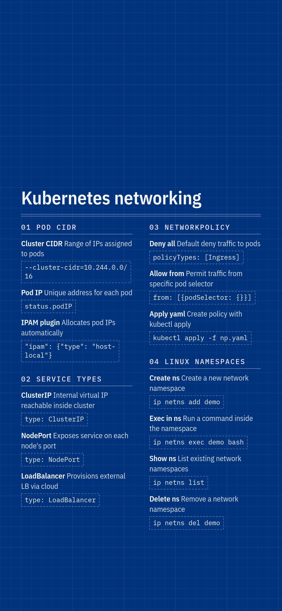
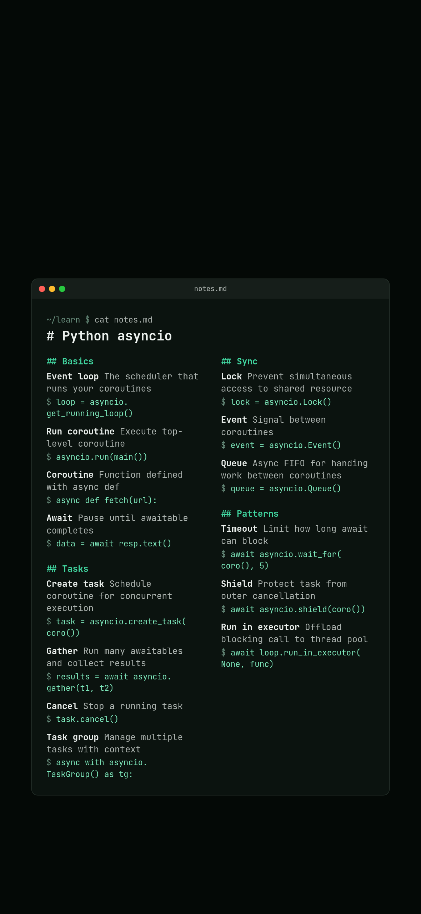
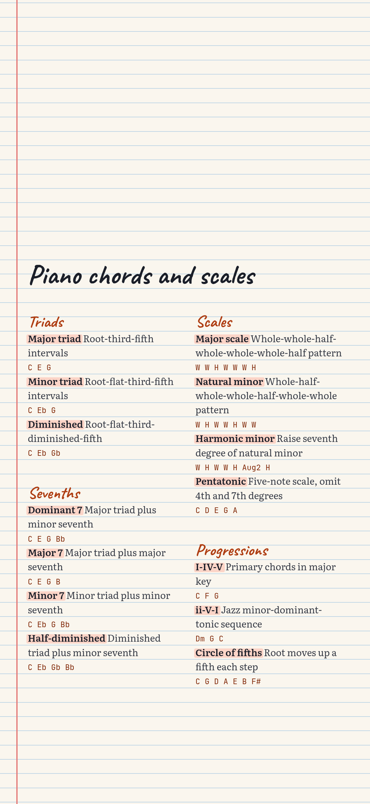
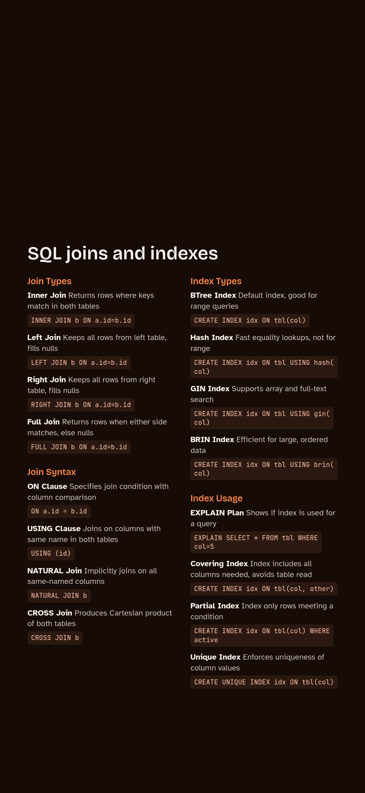
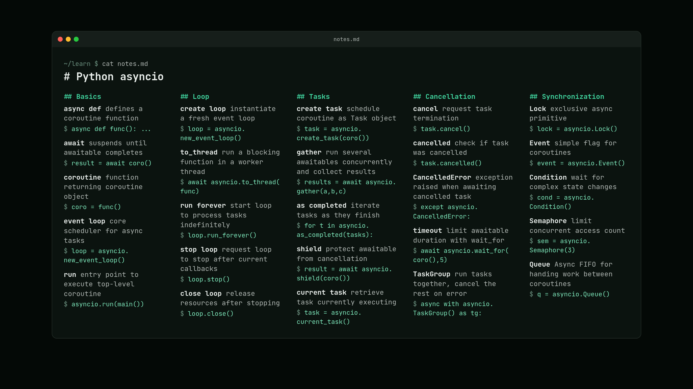
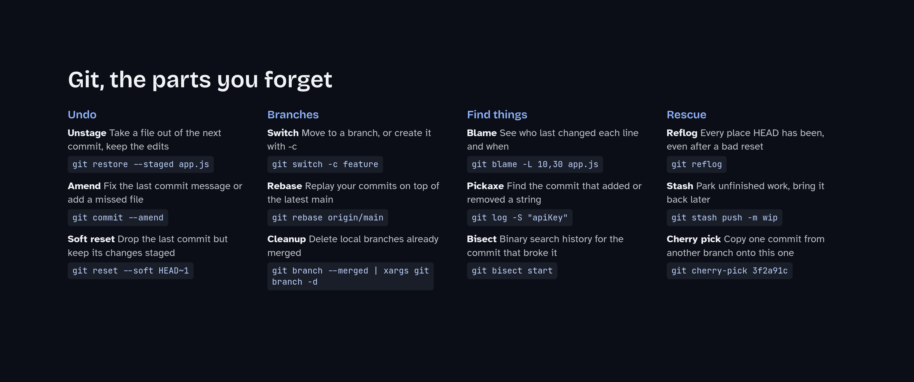

# cramwall

Turn what you're learning into a cheatsheet wallpaper for your phone lock screen or your desktop.

Type a few topics, pick a look and a colour, choose your screen size, download a PNG at the exact resolution. Every unlock is a quick review.

**Try it:** https://cramwall.vercel.app

<p>
  
  
  
  
</p>





More desktop samples at 1080p, 1440p, 4K, ultrawide, MacBook and dual monitor sizes are in [`samples/pc`](samples/pc).

## What it does

- **Topics in, cheatsheet out.** "kubernetes networking, linux namespaces" becomes 4 to 8 sections of terms, one line explanations and real commands.
- **Four looks.** Minimal, terminal, blueprint and notebook. Pick any colour and the whole palette is derived from it, with text contrast checked (4.5:1 or better).
- **Exact sizes.** iPhone, Pixel and Android presets, desktops from 1080p, 1440p and 4K to MacBook Retina screens (2880 x 1800, 3024 x 1964) and ultrawides (3440 x 1440, 5120 x 1440), or any custom size. Drawn on a canvas at full resolution, so text is pixel sharp.
- **Safe areas.** On phones the text stays under the lock screen clock and above the torch and camera buttons. On desktops you pick your OS and the text stays clear of what it draws: the Windows taskbar and desktop icons, the macOS menu bar, Dock and icons, or a Linux top bar (GNOME, Hyprland waybar) or bottom panel (KDE). Bar sizes follow the screen's usual display scale. The preview can show them on top.
- **Readable on big screens.** Desktop text scales with the screen, so 4K and Retina wallpapers read like 1080p does at 100%. Ultrawides get more columns in a centred block with wide margins, so lines never run edge to edge.
- **Two monitors.** Tick "Two monitors" and the sheet splits across two PNGs, one per screen, with one font size and one top line so the pair reads as a single sheet.
- **Auto fit.** Picks the column count and the biggest font that fits your screen.
- **Edit anything.** Change any line, remove items, or regenerate one section without touching the rest.
- **Optional context.** A sentence about you, a GitHub username or a resume. It only sets the level (beginner, intermediate, advanced) and the language used in examples.

## Self host in one command

```bash
git clone https://github.com/SwapnilChand/cramwall && cd cramwall && npm install && GROQ_API_KEY=your_key npm start
```

Open http://localhost:3000. That's it: no database, no account.

### Bring your own key

Set one of these. The first one found wins.

| Provider | Env var | Default model |
| --- | --- | --- |
| Any OpenAI compatible server (Ollama, OpenRouter, Together, vLLM) | `LLM_BASE_URL` (+ `LLM_API_KEY`) | `llama3.1` |
| Groq | `GROQ_API_KEY` | `openai/gpt-oss-120b` |
| OpenAI | `OPENAI_API_KEY` | `gpt-4.1-mini` |
| Anthropic | `ANTHROPIC_API_KEY` | `claude-opus-5-5` |

`LLM_MODEL` overrides the model for any of them. Fully local with Ollama:

```bash
LLM_BASE_URL=http://localhost:11434/v1 LLM_MODEL=qwen2.5:14b npm start
```

Other settings (see `.env.example`):

| Env var | Default | What it does |
| --- | --- | --- |
| `SHEETS_PER_DAY` | `5` | Full generations per visitor per day. `0` turns the limit off. |
| `SECTIONS_PER_DAY` | `20` | Single section redos per visitor per day. |
| `KV_REST_API_URL`, `KV_REST_API_TOKEN` | none | Upstash Redis for limits shared across serverless instances. Without them, limits are kept in memory. |
| `LLM_REASONING` | `medium` | Reasoning effort for gpt-oss models. |
| `PORT` | `3000` | Port for `npm start`. |

### Deploy to Vercel

Import the repo in Vercel, add one key from the table above, deploy. Add the Upstash integration if you want the rate limit to hold across instances.

## How it works

```
topics + level ──> /api/generate ──> model returns strict JSON ──> validated server side
                                                                        │
          PNG at device size <── canvas templates <── your edits <──────┘
```

1. The browser sends the topics, the screen type and, if you added it, a short context text.
2. If there is context, one small call turns it into `{ level, languages }` and the text is dropped. Only those two fields reach the main prompt.
3. The model must answer in a fixed JSON schema: a title, 4 to 8 sections, 3 to 6 items each, every item a term, one line and an optional command. The server checks and trims every field (`api/_schema.js`) before anything is drawn. The model never controls layout, colours or anything outside those strings.
4. Hand made templates draw the sheet onto a canvas at the exact device resolution (`src/render.js`). No image generation.

## Privacy

- Nothing about a request is logged or stored. Rate limits use a salted hash of the IP that changes every day.
- Resumes are read in your browser with pdf.js. Emails and phone numbers are stripped, then at most 2,400 characters are sent once to pick the level and are not kept.
- GitHub lookups go straight from your browser to the public GitHub API.
- Your last sheet and settings are saved in your own browser (localStorage) only.

## Develop

```bash
npm install
GROQ_API_KEY=your_key SHEETS_PER_DAY=0 npm run dev   # site + API with hot reload on :5173
npm test                                              # schema, validation, provider and layout tests
node scripts/render.mjs samples/sheets/k8s-phone.json samples/tmp blueprint iphone-pro '#2f6fd6'
node scripts/render.mjs samples/sheets/k8s-desktop.json samples/tmp minimal fhd,uhd,uw '#41d6a0' dark mac
node scripts/render.mjs samples/sheets/k8s-desktop.json samples/tmp minimal fhd '#41d6a0' dark windows dual
```

`scripts/render.mjs` renders any sheet JSON through the real app in headless Chromium, which is how the samples in this README were made. Devices are the ids in `src/render.js` (`fhd`, `qhd`, `uhd`, `mbp14`, `uw`, `suw`, ...) or `WIDTHxHEIGHT`; the OS is `windows`, `mac`, `linux-top` or `linux-bottom`. Set `BASE` to the dev server URL and `CHROME` if Chromium is not at `/usr/bin/chromium`.

Project layout:

```
api/generate.js    the one endpoint (sheet or single section)
api/_schema.js     JSON schema, validation and cleanup
api/_prompt.js     prompts
api/_llm.js        Groq, OpenAI, Anthropic and OpenAI compatible providers
api/_limit.js      per visitor daily limits
src/render.js      layout and canvas drawing
src/themes.js      the four looks and palette rules
src/make.js        the maker UI at /make
server.mjs         self host server
```

## Contributing

New looks are the most fun place to start: a template is a palette function, fonts and a few drawing switches in `src/themes.js`. Open an issue with a sketch first.

## License

MIT
